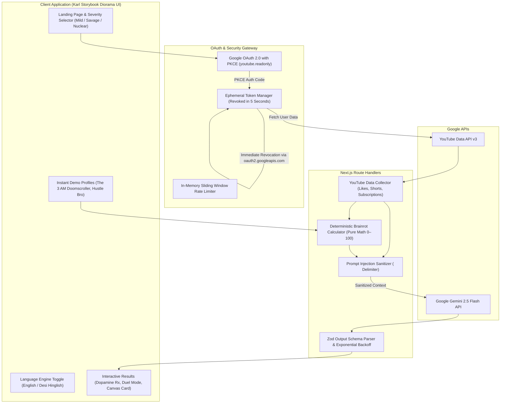

# YouTube Roast — AI Dopamine & Attention Span Teardown

## Deterministic Brainrot Scoring and Fact-Grounded Comedy Roasts Powered by Gemini 2.5 Flash

**YouTube Roast** is an open-source, AI-powered entertainment and digital wellbeing platform that audits your real YouTube watch habits, sub-60-second dopamine traps (Shorts), and subscriptions to calculate your mathematical **Brainrot Score (0–100)** and serve a savage, fact-grounded roast. Built using the hand-illustrated **Karl Pop-Up Storybook Diorama** design aesthetic, it pairs deterministic algorithms with **Google Gemini 2.5 Flash** to roast your taste without generic clichés—quoting real channels, playlists, and viewing ratios across English and colloquial Hinglish comedy engines while adhering to zero-data-retention security protocols.

---

### Tech Stack

- **Client** - Next.js 16 (App Router), React 19, TypeScript, Tailwind CSS v3 (Karl Storybook Diorama Design Tokens), Lucide Icons, `html-to-image`, `canvas-confetti`
- **Server** - Node.js runtime (Next.js Route Handlers), Google Gemini 2.5 Flash (Generative Language API), Google OAuth 2.0 (PKCE), YouTube Data API v3, Zod, AES-256-GCM Encryption

---

## Architecture & System Workflow

The diagram below illustrates the end-to-end data flow—from authenticated YouTube telemetry extraction and ephemeral token disposal to deterministic math scoring and Gemini prompt generation:



---

## Installation and Usage Instructions (For End-Users)

If you are an evaluator, streamer, or user who wants to run and explore YouTube Roast locally without modifying code, follow these quick steps:

### 1. Quick Launch (Run Locally)

Ensure you have **Node.js (v20+ LTS)** installed. In your terminal:

```bash
# 1. Clone the repository
git clone https://github.com/h-adarsh/youtube-roast.git
cd youtube-roast

# 2. Copy the sample environment file
cp .env.example .env.local

# 3. Install dependencies and start the app
npm install
npm run dev
```

Open [http://localhost:3000](http://localhost:3000) in your browser.

> [!TIP]
> **Zero-Setup Demo Mode:**
> You do **not** need Google Cloud credentials to test the application! If you launch the app without adding Google API keys to `.env.local`, YouTube Roast automatically runs in **Demo Mode**, letting you test real roasts across pre-computed profiles instantly.

---

### 2. Available Demo Profiles

You can test the scoring algorithm and roast generation immediately using the one-click demo profiles on the homepage:
- **The 3 AM Brainrot Doomscroller:** High Shorts-to-longform ratio, unhinged meme compilations, dopamine fatigue.
- **The 5 AM Cold-Shower Hustle Bro:** Dropshipping guides, self-improvement podcasts, sigma grindset loops.
- **The Cozy Nostalgia Escapist:** Retro video game soundtracks, lofi beats, 2000s cartoon reruns.

---

### 3. How to Use the System as a Consumer

#### Choosing Your Comedy Engine & Severity
1. On the landing page, select your preferred humor language:
   - **English Mode:** Contemporary internet slang (*brainrot, caught in 4K, dopamine receptors on life support*).
   - **Hinglish Mode (Desi Humor):** Authentic colloquial humor inspired by Tanmay Bhat and CarryMinati with culturally relatable punchlines.
2. Select your severity tier:
   - `Mild` — Gentle sibling teasing.
   - `Savage` — Brutally honest reality check.
   - `Nuclear` — Unhinged, existential teardown.

#### Authenticating & Privacy "Ghost Mode"
1. Click **Roast My YouTube**.
2. Sign in via Google's secure OAuth consent screen (read-only access).
3. **Private Likes Protection:** If your YouTube account has *"Keep all my liked videos private"* enabled, the app automatically switches to **Ghost Mode**—roasting your public playlists and subscriptions instead of crashing.
4. **Instant Token Disposal:** As soon as data is retrieved, your access token is cryptographically revoked within 5 seconds.

#### Reviewing the Teardown & Dopamine Rx
- **Deterministic Brainrot Score (0–100):** View your score calculated strictly via math from your Shorts ratio, binge concentration, and subscription sprawl.
- **Dopamine Prescription Rx:** Inspect your comical clinical diagnosis (e.g., *Acute Shorts-Induced Cerebral Decay*), brainrot stage assessment, and required recovery dosage (*"45 minutes of touching physical grass with shoes off"*).
- **Friend Duel Mode (`/duel`):** Challenge friends to a side-by-side battle comparing scores and channel dependencies.
- **Downloadable Share Cards:** Click **Export Card** to render a high-contrast, square shareable badge via client-side canvas for X (Twitter) or Instagram.

---

#### Consuming via REST API (Direct Client Usage)
End-users and external integrations can trigger roasts programmatically:

- **Generate Roast from Sanitized Profile Telemetry:**
  ```bash
  curl -i -X POST http://localhost:3000/api/roast/generate \
    -H "Content-Type: application/json" \
    -d '{
      "profile_name": "Demo Doomscroller",
      "severity": "savage",
      "language": "hinglish",
      "metrics": {
        "shorts_ratio": 0.85,
        "top_channels": ["Skibidi Central", "GTA 5 Clips", "Subway Surfers BG"],
        "subscription_count": 84
      }
    }'
  ```

---

## Installation and Usage Instructions (For Contributors)

Follow these technical instructions to clone the repository, configure live Google OAuth credentials, integrate Gemini 2.5 Flash, and run the developer suite.

### Prerequisites

- **Node.js:** v20.0.0+ LTS
- **npm:** v10.0.0+
- **Google Cloud Console Account:** For YouTube Data API v3 credentials
- **Google AI Studio Key:** For Gemini 2.5 Flash

---

### Step 1: Clone Repository & Install Dependencies

```bash
git clone https://github.com/h-adarsh/youtube-roast.git
cd youtube-roast
npm install
```

---

### Step 2: Configure Environment Variables

Create `.env.local` from the provided template:
```bash
cp .env.example .env.local
```

Populate the required keys:
```ini
# Google OAuth 2.0 Credentials (from Google Cloud Console)
GOOGLE_CLIENT_ID=your-google-client-id.apps.googleusercontent.com
GOOGLE_CLIENT_SECRET=your-google-client-secret
GOOGLE_REDIRECT_URI=http://localhost:3000/api/auth/callback

# Google Gemini API Key (from Google AI Studio)
GEMINI_API_KEY=your-gemini-api-key

# Session Encryption Secret (minimum 32 characters)
SESSION_SECRET=super_secret_session_key_at_least_32_characters_long

# Local Application URL
NEXT_PUBLIC_SITE_URL=http://localhost:3000
```

---

### Step 3: Google Cloud Console Setup (Live Mode)

To enable live Google login with YouTube access:

1. Open the [Google Cloud Console](https://console.cloud.google.com/) and create a project (`youtube-roast`).
2. **Enable API:** Navigate to **APIs & Services > Library**, search for **YouTube Data API v3**, and click **Enable**.
3. **Configure OAuth Consent Screen:**
   - User Type: **External**
   - Scopes: Add `https://www.googleapis.com/auth/youtube.readonly`
   - Test Users: Add your personal Google email address under **Test Users** (unverified apps can support up to 100 test accounts).
4. **Create Credentials:**
   - Go to **APIs & Services > Credentials > Create Credentials > OAuth client ID**.
   - Application Type: **Web application**.
   - Authorized JavaScript origins: `http://localhost:3000`.
   - Authorized redirect URIs: `http://localhost:3000/api/auth/callback`.
5. Copy the **Client ID** and **Client Secret** into your `.env.local`.

---

### Step 4: Start the Development Server

Launch the Next.js development server with Turbopack:

```bash
npm run dev
```

Open [http://localhost:3000](http://localhost:3000).

---

### Step 5: Code Quality & Verification

```bash
# Verify TypeScript types and build production bundles
npm run build

# Run ESLint validation
npm run lint
```

---

## Contributor Expectations

We welcome contributions to YouTube Roast! To preserve comedic originality, mathematical determinism, and strict privacy boundaries, contributors must observe the following ground rules:

### 1. Workflow & Issues Protocol
- Open an issue prior to introducing new humor engines, scoring weight formulas, or UI themes.
- Reference the issue number in all PR descriptions.

### 2. Branch Naming Conventions
- `feature/<short-description>` — New features (e.g., `feature/spotify-crossover-roast`)
- `fix/<short-description>` — Bug fixes (e.g., `fix/ghost-mode-empty-playlist-handling`)
- `docs/<short-description>` — Documentation updates (e.g., `docs/oauth-pkce-guide`)
- `refactor/<short-description>` — Performance improvements without functional changes

### 3. Commit Message Standards
Follow [Conventional Commits](https://www.conventionalcommits.org/):
- `feat: implement CarryMinati-inspired punchline generator in Hinglish engine`
- `fix: resolve canvas rendering offset in html-to-image export card`
- `test: add unit tests for deterministic brainrot scoring algorithm`
- `docs: update contributor setup steps for Gemini 2.5 Flash`

### 4. Architectural & Security Ground Rules
- **No Hallucinated Scores:** The **Brainrot Score (0–100)** must strictly be computed via mathematical code in `lib/scoring.ts`—never let the AI model hallucinate numbers.
- **Ephemeral Token Lifecycle:** User access tokens must **never** be stored in persistent databases. Every token must trigger an immediate revocation call to `oauth2.googleapis.com/revoke` within 5 seconds of telemetry extraction.
- **Prompt Injection Isolation:** All raw YouTube strings (video titles, playlist names, channel handles) must be sanitized and strictly wrapped within delimited `<USER_DATA>` tags to prevent jailbreak attacks.
- **Output Schema Conformance:** Every Gemini output must be validated against declarative Zod schemas. If parsing fails, fall back to the deterministic template engine.
- **Visual Identity Purity:** UI contributions must strictly adhere to the **Karl Pop-Up Storybook Diorama** design tokens: Signal Yellow (`#ffe600`), Azure (`#007fff`), Roof Coral (`#ef3b2c`), crisp `#333333` Charcoal Ink borders, and Changa One display typography with zero blurry shadows or generic gradients.

### 5. Pull Request Checklist
1. Application builds cleanly with zero errors (`npm run build`).
2. Lint checks pass without warnings (`npm run lint`).
3. No API keys or Google Cloud credentials committed.
4. Link the relevant issue (`Closes #<issue_number>`).
